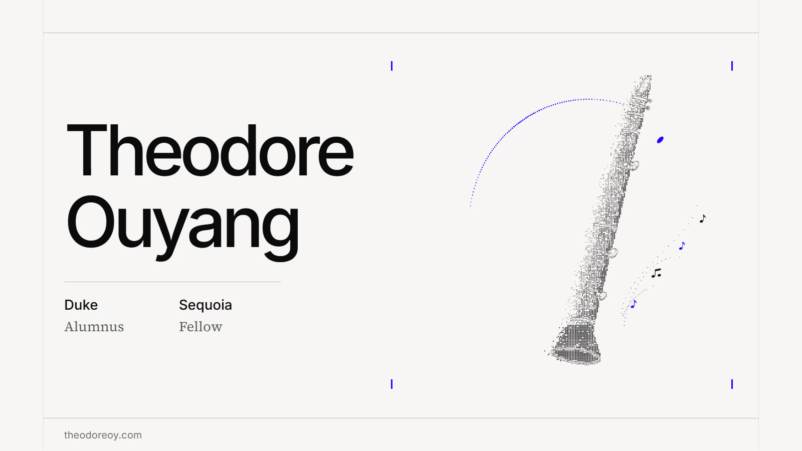

# Theodore Ouyang's Personal Website

I am a Duke alumnus and Sequoia Fellow. My work makes high-stakes conclusions verifiable across derivative pricing, frontier AI evaluation, and law. This site brings together my academic background, industry experience, and written work.

**[Visit the website](https://www.theodoreoy.com/)**

  

## A personal introduction

The homepage pairs my name and background with a clarinet drawn from separated particles. Moving the pointer gently displaces nearby points, which spring back into place; scrolling disperses the composition and returning restores it. Four musical notes move continuously beside the instrument, while reduced-motion settings show a complete static illustration.

The rest of the design is deliberately quiet: warm paper, clear typography, and generous space for the work itself.

## Academic background and research

[About](https://www.theodoreoy.com/) covers my **B.S. in Mathematics and M.Eng. in Risk Engineering at Duke**, selected coursework, and mathematical finance research.

Selected Research presents *Critical Dependence Stress for Portfolio Diversification* and two manuscripts on certified option valuation. The Asian-options work connects a weighted payoff-remainder argument to a complete Heston discretization-error bound. The Rough Heston work carries fractional Riccati residuals into joint price-error certificates, showing how shared numerical errors can change a portfolio's certification result.

All three papers can be read on the site, with equations, chapter navigation, references, and links to their research repositories.

## Experience across five fields

[Experience](https://www.theodoreoy.com/experience/) presents eighteen projects and roles across five fields, with summaries and dedicated pages for their methods and contributions.

| Field | Work represented |
| --- | --- |
| **AI Research and Engineering** | Expert-data quality control, financial synthetic-data design, scientific reasoning evaluation, and AI-driven investment research. |
| **Data Science** | Issuer ranking as a data scientist at Jiritsu, market-entry data analysis at Euromonitor, and sustainability screening at China Construction Bank. |
| **Legal Research and Policy Analysis** | Papers on autonomous authority in space, strategic infrastructure dependence, solar geoengineering, and ecological restoration. |
| **Finance and Consulting** | Real estate underwriting at JLL, satellite commercialization research for Hubble, investment diligence at SAIF, equity research at CITIC, and business restructuring at EY-Parthenon. |
| **STEM Academic Competitions and Training** | Advanced physics and mathematics training, competition awards, peer mentoring, and independent Olympiad instruction. |

Every entry has a Read More page with its role, location, dates, and Key Contributions. The AI and legal pages also include the research articles, each opening with a diagram of its system or argument, so visitors can follow the underlying reasoning.

## About the site

I built the site with Next.js, React, TypeScript, and native CSS. A shared reading layout brings research and experience into the same visual system, with mathematical notation and legal footnotes presented as part of the text.

[Architecture](https://www.theodoreoy.com/architecture/) · [Design](../docs/design.md) · [Development guide](../website/README.md) · [Maintenance](../docs/maintenance.md)
