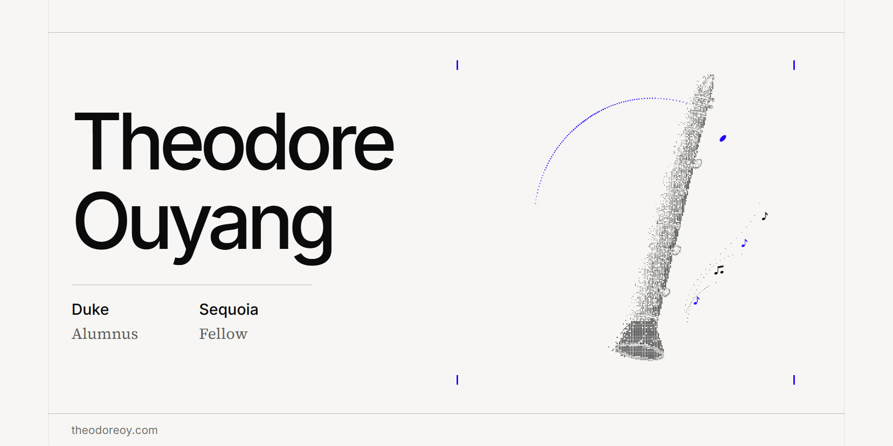

# Theodore Ouyang

Duke Alumnus, B.S. in Mathematics and M.Eng. in Risk Engineering · Sequoia Fellow

[theodoreoy.com](https://www.theodoreoy.com/) · [Email](mailto:10@alumni.duke.edu) · [X](https://x.com/D3rfr31schutz)

**Thinking mathematically, working in artificial intelligence.** I look past what a model does to the mathematics of why it does it. I am a research engineer at a foundation model company, where I build personal agents, and I have worked with a frontier AI lab and a leading global alternative asset manager.

## Selected Research

Three papers in quantitative finance whose central results are proved theorems and certified bounds.

- **[Critical Dependence Stress for Diversification Gains under Fixed Marginals](https://www.theodoreoy.com/critical-dependence-stress-for-diversification-gains-under-fixed-marginals/)**\
  The dependence stress that reverses a diversification trade's Expected Shortfall advantage is quadratic in the trade size, and in the uniform benchmark it is at least 30% above the tangent prediction.
- **[Certified Valuation of Arithmetic Asian Options](https://www.theodoreoy.com/certified-valuation-of-arithmetic-asian-options/)**\
  Deciding exercise on the geometric average costs a one-month crude oil option less than a hundredth of a cent per barrel, against 2.6 cents for the classical first-order bound. Under Heston the bound becomes a certified price interval.
- **[Certified Joint Pricing Errors in Rough Heston](https://www.theodoreoy.com/certified-joint-pricing-errors-in-rough-heston/)**\
  One transform error is common to every strike at an expiry, so a portfolio nets it. On S&P 500 options, netting the legs certifies a half-point tolerance for all 28 six-month spreads, butterflies, and baskets tested, against 13 without.

## Experience

**Law.** Four articles from Duke Law School on who may decide under risk: [autonomous authority in space](https://www.theodoreoy.com/experience/autonomous-authority-in-space/), [small states and strategic space dependence](https://www.theodoreoy.com/experience/small-states-and-the-governance-of-strategic-space-dependence/), [solar geoengineering](https://www.theodoreoy.com/experience/who-may-choose-the-lesser-risk/), and [mangrove restoration and compensatory mitigation](https://www.theodoreoy.com/experience/mangrove-restoration-and-the-limits-of-compensatory-mitigation/).

**Industry.** Jiritsu Network · Euromonitor International · China Construction Bank · Jones Lang LaSalle · Hubble Network · SAIF Partners · CITIC Securities · EY-Parthenon

[All Experience](https://www.theodoreoy.com/experience/)

## Repository

This repository builds theodoreoy.com with the same care as the work it presents: a Next.js static export, a Canvas 2D clarinet drawn from separated particles, mathematics typeset to SVG at build time, figures drawn from each manuscript's own numbers, and tests that cover every route and every line of visible copy.

[Design](../docs/design.md) · [Maintenance](../docs/maintenance.md) · [Development](../website/README.md) · [Architecture](https://www.theodoreoy.com/architecture/)
