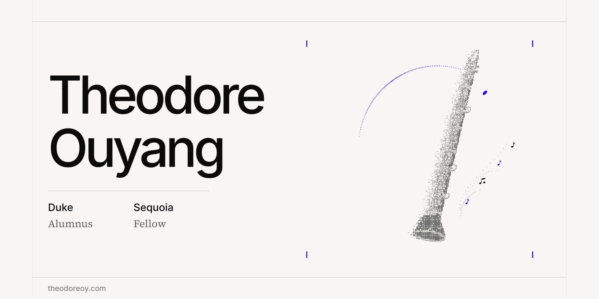

  

# Theodore Ouyang

**I make high-stakes conclusions verifiable:** certified error bounds in derivative pricing, layered verification in frontier AI evaluation, and evidence standards for delegating authority to autonomous systems.

Duke Alumnus, B.S. in Mathematics and M.Eng. in Risk Engineering · Sequoia Fellow

[theodoreoy.com](https://www.theodoreoy.com/) · [Email](mailto:10@alumni.duke.edu) · [X](https://x.com/D3rfr31schutz)

## Selected Research

- **[Critical Dependence Stress for Portfolio Diversification](https://www.theodoreoy.com/critical-dependence-stress-for-portfolio-diversification/)**
  How much dependence stress reverses a portfolio's Expected Shortfall advantage while every loss distribution stays fixed. The asymptotic reversal budget is at least 30% above the initial-sensitivity prediction.
- **[Certified Valuation of Arithmetic Asian Options](https://www.theodoreoy.com/certified-valuation-arithmetic-asian-options/)**
  A weighted payoff-remainder method that turns an exact conditional price representation into certified valuations, with a complete Heston discretization-error bound below 0.011025 price units.
- **[Certified Joint Pricing Errors in Rough Heston](https://www.theodoreoy.com/certified-rough-heston-valuation/)**
  A method for certifying portfolio valuation errors in rough Heston. By preserving numerical errors shared across options, it can certify portfolio tolerances that separate price bounds cannot.

## AI Research and Engineering

- **[Large-Scale Domain Expert Feedback Governance and Adaptive Review](https://www.theodoreoy.com/experience/statistical-inference-and-resource-allocation-in-expert-data-production/)**
  A statistical decision framework for measuring and improving expert-generated training data, supporting a program of more than 300 specialists.
- **[Financial Task Design and Synthetic Data Engineering](https://www.theodoreoy.com/experience/task-validity-in-financial-synthetic-data/)**
  A framework for scaling financial training data while preserving the validity of its supervision. I created Batch Zero to establish these standards, and the partner company adopted it across other post-training programs.
- **[General Reasoning Evaluation and Layered Verification](https://www.theodoreoy.com/experience/verification-and-supervision-in-scientific-reasoning-tasks/)**
  A proof-obligation framework linking conclusions to their assumptions, derivations and execution evidence. Across 3,600 constructed submissions, the certificate verifier accepted every valid proof and rejected every invalid one.
- **[Evidence Verification and Robust Comparison in Investment Research](https://www.theodoreoy.com/experience/evidence-uncertainty-and-decision-guarantees-in-investment-research/)**
  A decision-theoretic framework for investment due diligence that determines which conclusions the evidence supports and which facts are most valuable to verify next.

## Legal Research

Four papers written at Duke Law School: [autonomous authority in space](https://www.theodoreoy.com/experience/autonomous-authority-in-space/), [small states and strategic space dependence](https://www.theodoreoy.com/experience/small-states-and-strategic-space-dependence/), [solar geoengineering](https://www.theodoreoy.com/experience/solar-geoengineering-comparison-and-continuity/), and [mangrove restoration and compensatory mitigation](https://www.theodoreoy.com/experience/mangrove-restoration-and-compensatory-mitigation/).

## Industry

Jiritsu Network · Euromonitor International · China Construction Bank · Jones Lang LaSalle · Hubble Network · SAIF Partners · CITIC Securities · EY-Parthenon

[All Experience](https://www.theodoreoy.com/experience/)

## This Repository

The site is built with the same care as the work it presents: a Next.js static export, a Canvas 2D clarinet drawn from separated particles, mathematics rendered to SVG at build time, figures drawn from each manuscript's own numbers, legal footnotes that open in place, a strict content security policy, and tests that cover every route and every line of visible copy.

[Design](../docs/design.md) · [Maintenance](../docs/maintenance.md) · [Development](../website/README.md) · [Architecture](https://www.theodoreoy.com/architecture/)
